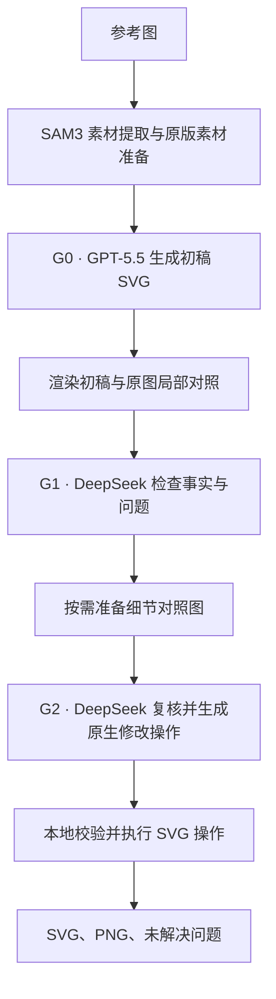

# FigFox 原版流程与网页适配核查

核查日期：2026-11-05。目标是确认网页接入的真实调用链及差异，不以单张结果成功代替一致性验证。

## 当前 GitHub 入口的流程

远程 main 已核实为 [21ffc01271904d6c5610f0f96afd84530968f11e](https://github.com/LawrenceRiver/FigFox/commit/21ffc01271904d6c5610f0f96afd84530968f11e)。执行入口：[`src/figfox_plus/factual/pipeline.py`](https://github.com/LawrenceRiver/FigFox/blob/21ffc01271904d6c5610f0f96afd84530968f11e/src/figfox_plus/factual/pipeline.py)。

G0 调用 `native.pipeline.first`，开启 SAM、关闭额外 code-methods 能力；素材准备、绑定和布局约束均沿用原版。原版本身的 SAM 素材总览保留。

G1 查看原图、初稿及 A/B/C/D 四个区域的对照图，记录事实、问题、未知项，可提出最多六个细节查看请求。G2 接收这些图像、细节图、初稿 SVG、对象索引、G1 报告和操作契约，复核后产生具体操作。原版校验事实、范围、操作依赖和目标，再执行 `set`、`text`、`remove`、`append_svg`、`replace_svg`、`source_crop` 等操作。

当前入口没有独立的 D1 翻译器、DeepSeek 缺口指导调用或 D2 多轮视觉复审循环。已有架构图把 G0/G1/G2 标为 GPT，并画了 DeepSeek 补充指导分支；该图与当前默认配置及执行入口并非逐项一致，不能声称那条分支已经实现。结果状态是 `execution_complete`，`visual_quality_pass=null`，`scoring_status=not_scored`。

## 模型版本与流程分开记录

上游 `configs/factual.json`：G0 为 GPT-5.5，G1/G2 为 `deepseek-v4-flash-vision-exp`；`historical-cohort.json` 则把三阶段都设为 GPT-5.5。两者调用相同 factual 入口。

用户本轮明确指定 DS V4.1 Flash，因此网页使用 `deepseek-flash`。官方文档确认它当前对应 V4.1 Flash，旧视觉实验型号名也会转接过去；本机无付费的模型列表查询返回 `deepseek-flash`。旧别名未出现在列表中，不等于其请求一定被拒绝。[接口说明](https://api-docs.deepseek.com/quick_start/)

网页当前配置相对原文件仅明确调整：

| 字段 | 原默认 | 网页当前 |
| --- | --- | --- |
| G1/G2 模型 | deepseek-v4-flash-vision-exp | deepseek-flash |
| G1/G2 缓存输入费率 | 0.003 / 百万 | 0.006 / 百万 |
| G1/G2 输出费率 | 0.4 / 百万 | 1.2 / 百万 |
| 预算 | 原批次 169.93383 USD | 单图至多 5 USD，并受累计剩余额度约束 |
| price_basis | 实验记录费率说明 | 当前 DS 高峰价保守预留说明 |

普通输入费率保持 0.3 / 百万。费率使用 [2026-11-05 查到的高峰价](https://api-docs.deepseek.com/quick_start/pricing/) 防止按旧输出单价低估预留；展示费用仍是估计，非账单实付。源配置文件未修改，差异写入运行配置和每个新任务的 `adapter-contract.json`。

没有修改提示词、角色分工、推理参数、输入/输出限制、超时和传输方式。原版输入上界 131072 仍保留；更新模型名称不等于自动扩大这个上界。

## 本地资料包与 GitHub 的区别

资料包：`D:/Downloads/FigFox-研究资料总库/FigFox-研究资料总库`。

| 内容 | 检查结果 |
| --- | --- |
| `03-全部源码/figfox-current`、`figfox-main` | 不同的较早源码提交，包含 GPT 初稿与 DeepSeek 后续检查修复；均没有当前 `factual/pipeline.py` |
| `03-全部源码/figfox-publication-20261031` | 文档描述 GPT 初稿、D1 实用性门控、C1/C2 检查规划、D2 复审与有限回派；文档同时说明该监督式结构尚未完整集成为当前实验执行器 |
| `01-实验/原始运行与失败账本/runner.py` | 最新 80 图实际实验脚本复用已有 G0，G1/G2 实际调用 OpenAI/GPT-5.5，DeepSeek 做独立双评审；有复用 pilot 的特定 scope 修正记录 |
| 当前 GitHub main | factual 单轮检查、规划、原生执行入口；默认 GPT 初稿、DeepSeek G1/G2 |

实际 runner 的调用语句优先于未被调用的配置字段或提示词常量。不能因为目录是“最新完整包”，就把其中所有代码、设计文档、历史产物视为同一版本。上述特定 pilot 修正也不等于通用 DeepSeek 缺口指导分支。

## 发现并移除的适配层改动

此前仅核对内核目录不足以证明完整移植：外部网页适配层也会改变请求。这次移除了：

- SAM 小切片缩成 232×202 缩略图、额外图板与附件清单重写。
- G1/G2 的额外证据拼板和映射提示词。
- G0 输入限制从 131072 放大到 262144。
- 用户补充要求直接附加到原版 G0 提示词。
- 原版同步请求被替换成 SSE/后台任务，以及连接自动重试。
- PNG/JPEG 上传时的 EXIF 转向、透明度铺白和重新编码。
- 将全 GPT 历史模型配置当作当前默认配置使用。

网页现在只负责上传、任务、真实阶段进度、保守预算、结果展示和失败反馈。PNG/JPEG 字节原样保存；WebP 记录为同像素 PNG 格式转换，并留存上传原件。用户备注保留在草稿，原入口无用户提示词参数，因此不附加进模型请求。

## 源码与请求对照证据

上游下载包 SHA256：`cb8dd3e9bb794fda4fef627b5468e2d42179f5a5cb8ed3e082262c5d0ad0603f`。

核对 1111 个归档文件，仅允许三处 Windows 兼容差异：

1. `factual/pipeline.py`：Windows 使用 `msvcrt` 运行锁，POSIX 保持 `flock`。
2. `providers.py`：旧分支使用时才导入 POSIX `fcntl`。
3. `adapters/raw_evidence.py`：Windows 不做目录描述符 fsync，文件 fsync 保留。

worker 每次启动重新核验所有文件与声明配置，拒绝额外 Python 模块及未知源文件修改。

SAM 服务另行核对：上游安装文档指定 DrawAI 的本地 SAM3 服务，仓库本身不包含权重。本机 bridge 直接把 `/v1/segment/proposals` 请求转交同一个 `LocalSam3Transport`，仅包装 HTTP、模型锁和耗时字段，使用 CPU；没有在 bridge 中换提示词或重新缩图。bridge SHA256 为 `5dce2783dd55eb2e041f8318b43500a584f16f364b9c4cdbf5bf9653cd4309be`，本机 `local_runtime.py` 为 `3deecf0ea755e4ddb72d62a27139a6f53fceb8ef20e5ffc6563309958306df70`。本轮检查了转发代码和健康状态，差分测试中的 SAM 响应是固定测试数据，未重新验证模型权重推理的逐像素一致性。

[`parity.json`](parity.json) 来自 `scripts/check-kernel-parity.py`：实际原版入口和实际网页 worker 使用相同声明配置、相同输入、固定 SAM/模型响应，网络连接被禁止。比较三个阶段的 URL、完整 HTTP 请求体（含附件字节）、超时、模型 JSON、实现计划、执行记录和最终 SVG/PNG。

- 80×64、无 SAM 素材：请求及结果完全一致。
- 609×277、三份 SAM 素材、细节查看请求、一项实际 SVG 修改：请求及结果完全一致。
- 再读取已完成结果没有产生额外模型请求。

这些固定响应测试证明覆盖路径中的包装一致性，不能证明任意图像的模型表现或所有异常路径。此前 005.png 的成功结果使用旧适配和历史配置，保留原结果与费用，但不作为本次恢复后的在线验证。

## 输入超限的具体原因

对此前失败的 G2 原始请求（10 张附件）做零网络复算，见 [`input-bound-audit.json`](input-bound-audit.json)：

- GitHub 当前公开传输器的输入上界估算：157293，超过 131072。
- 研究包旧实验估算器，用同一 prompt/payload/images 与其消息封装：42608。

二者是不同估算器的上界数值，不是实际 token 用量或账单，也不表示历史批次发送过完全相同的提示词。它说明这次超限可以在公开原版规则下发生；额外拼板曾改变了输入以绕过这一问题。本轮恢复原规则并明确报错，不靠改输入让验证看起来通过。

## 验证与发布范围

- 后端 49 项测试通过；上游 factual 4 项测试通过。
- 两组原版/网页请求及产物差分通过。
- 前端生产构建通过；既有大包提示保留。
- 实际浏览器验证通过：已有结果恢复、SVG/PNG 下载、编辑和导出、手机布局、生产构建不访问本地服务；页面展示原图模式，追加提示词入口关闭。浏览器没有提交任何新任务。
- 本轮未提交任何付费模型生成请求；无付费模型列表查询只核实型号可用性。
- 历史结果、费用记录、待确认预留和单图上限全部保留。
- 本地服务与网页代码更新；本轮不部署云端生成服务。
- 当前测试余额 1.550893 USD，低于 G0 原版请求预留 1.6384 USD；服务明确返回额度不足，没有增加预算或释放待确认费用。

### 全站检查的未通过项

额外执行 `npm run review:quality` 的 154 组扫描未全通过，不能将上述内核与专项浏览器检查写成“全站测试全部通过”。扫描报告首页图片缺少显式尺寸、桌面使用指南链接识别失败，以及英文手机工作台的示例按钮换行/模式切换区域检查失败；没有浏览器运行异常。该命令在布局检查退出后未继续运行对比度检查。

进一步仅扫描 `/workspace` 的中英双语七档宽度（14 组），复现了 6 组桌面导航检测失败、3 组英文手机模式切换检查失败，其中 320px 还报告示例按钮换行。现有脚本只查 `.product-nav` 等旧导航容器，没有覆盖当前侧栏。普通开发模式未启用本次的本地内核分支；本轮生产页面改动局限于本地重建状态，没有修改导航、示例按钮或布局样式。这些页面/检查脚本问题单独记录，未在内核审计中扩展修改。
