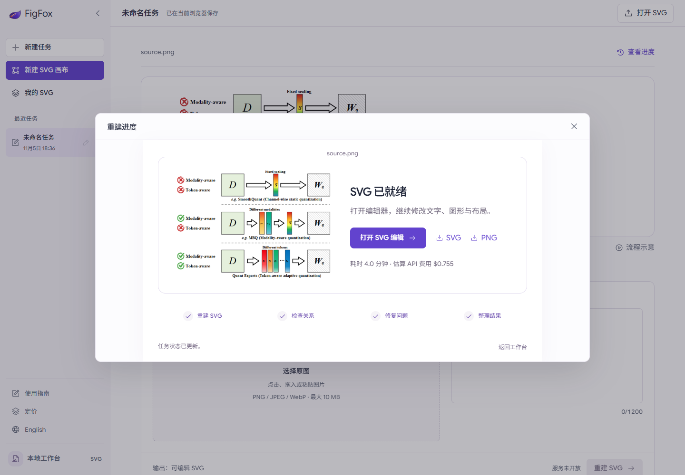
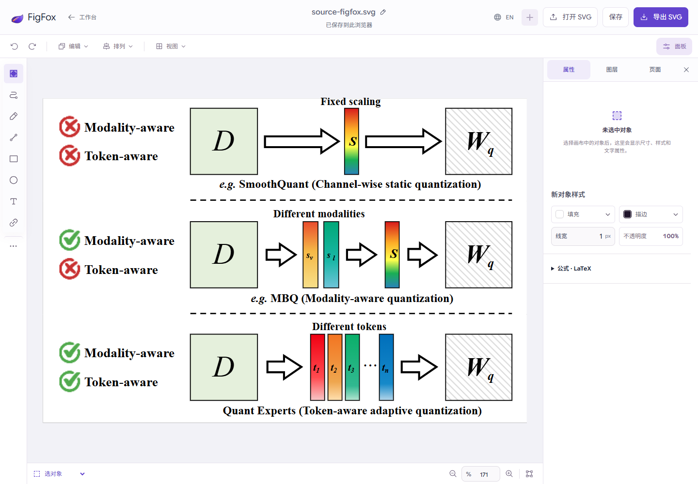
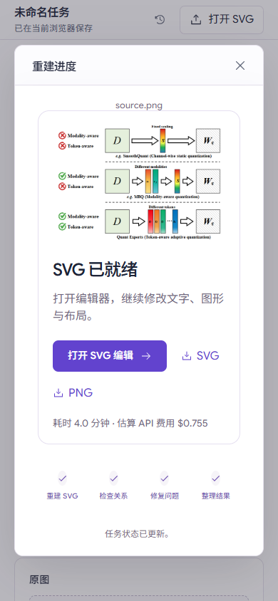

# Local FigFox reconstruction verification — 2026-11-05

The real browser-to-kernel-to-editor path completed. This is a one-image integration check, not a quality benchmark or cloud deployment.

## Actual execution

- Kernel: `LawrenceRiver/FigFox@21ffc01271904d6c5610f0f96afd84530968f11e`, factual pipeline.
- Input: archive reference `sample-0037/source.png`, 584 × 392; user note submitted through the workspace.
- SAM3: real CPU inference (first preparation ~49 s); the successful run reused the verified SAM cache from that preparation.
- G0/G1/G2: GPT-5.5, medium, derived from the repository's historical cohort configuration. The experimental default DeepSeek vision model was not used.
- Successful job: `b573f7136cb84f73810b6ac22c9d320a`, 241.78 seconds, estimated USD **0.755372** using provider usage and configured rates.
- Native execution: 6 planned / 6 executed operations, zero reported unresolved issues. Kernel `visual_quality_pass` remains `null` and `scoring_status` is `not_scored`.
- The original generated SVG and PNG were hash-verified. No manual modifications were made to either kernel artifact. A separate browser document was edited to test saving/export.

Earlier preparation attempts stopped before model calls on Windows portability and conservative input-size checks. One non-streaming model request disconnected after ~61 seconds, with no response usage received. Its full USD **2.293760** reserve is retained; it was not automatically retried. The successful run plus that reserve give total exposure USD **3.049132**, below the USD 5 test ceiling. Remaining USD **1.950868** is insufficient for the next G0 maximum reserve, so new submissions are disabled; existing results remain accessible. This reserve is not a confirmed billed charge.

The API connection was changed to Responses SSE using the kernel's HTTP injection point. Only completed provider responses are accepted, preserving the kernel's request IDs, receipts, cost accounting and output checks. Windows changes are reproducible through the checksum-verifying preparation script.

## Checks

- Backend: **35 passed**, including 8 local bridge/streaming cases. One upstream Starlette/httpx deprecation warning remains; no failures.
- Kernel factual pipeline: **4 passed** offline.
- Existing workspace browser checks: **6 groups passed**.
- Product motion / progress browser checks: **9 groups passed**.
- Real submission: upload, notes, auto-open progress, close/reopen, all four reported stages, completed preview and editor handoff passed.
- Real result: **5 groups passed** — refresh restores result, raw hashes/downloads match, text can be edited/exported, reopening preserves edits, mobile layout fits, production build does not probe local services or enable generation.
- `npm run build:pages`, backend Ruff, and `git diff --check` passed. Existing frontend large-chunk warnings remain.
- Browser checks reported no page errors. Result-only checks made zero POST requests and incurred no model charges.
- Restarted the local API using the startup script; the successful result survived and remained editable/downloadable.

## Review

The local bridge is a separate FastAPI entry point, leaving the existing cloud application unchanged. Loopback binding, exact local origins/hosts, upload limits, idempotency, a process lock, failure recovery, explicit artifact routes, browser SVG sanitization and private on-disk credentials were reviewed. No original archive, sibling kernel checkout, or production environment was modified. Secrets, model payloads and local runtime folders are excluded from Git.

This bridge is for one local user. Cloud authentication, ownership enforcement, shared durable storage, worker supervision and deployment remain future work. See [setup and boundaries](../../local-kernel.md).

## Screenshots

Detailed stage timing, provider usage and hashes are in [real-run.json](real-run.json); browser assertions are in [result-checks.json](result-checks.json).
