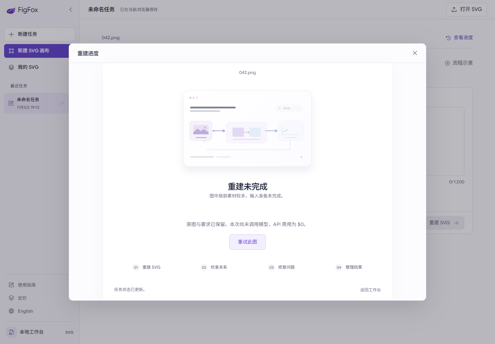
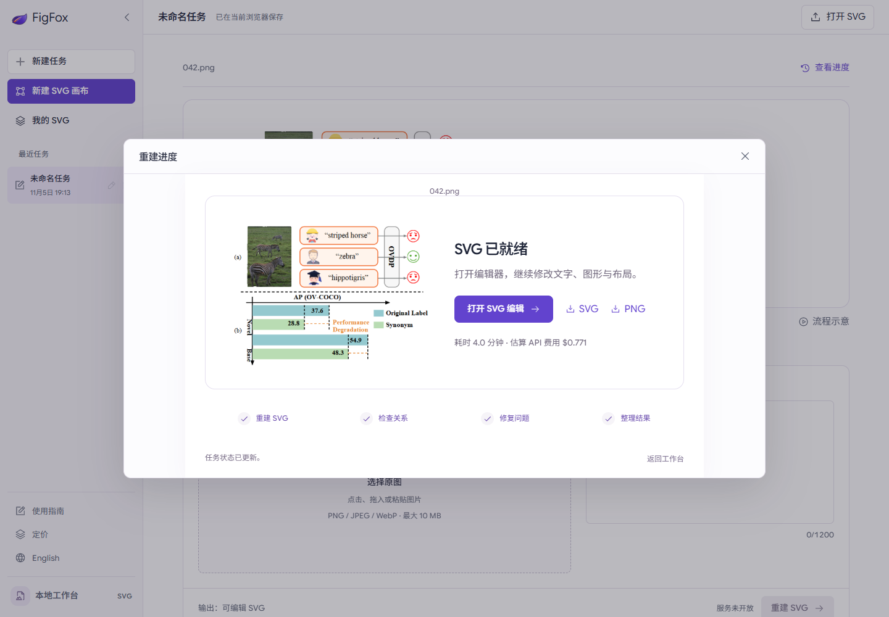

# Local reconstruction failure and recovery — 2026-11-05

The user's `042.png` (574 × 429) stopped before the first model HTTP request. SAM had produced 27 crops. With the source and annotated overview, 29 attachments exceeded the kernel's conservative input guard: 271,346 versus 262,144. No request receipt existed and the failed attempt incurred no model API charge.

The local adapter now packs overflowing G0 crop attachments into labelled contact sheets. Every crop ID is retained, the original source and overview remain full resolution, and native asset binding still uses the original crop bytes and source coordinates. The tested request contained four attachments with a conservative bound of 90,308. Input and cost limits were not raised. Original model responses and output SVG were not manually repaired.

The failure dialog identifies the failed stage and billing state. Recovery is allowed only for preflight failures with no request receipts. The same job ID and saved input are used; the original preparation records are archived. Revision-based deduplication, a process lock, a two-recovery limit and the existing budget guard prevent accidental repeat submissions. Paid/uncertain requests cannot be resent through this endpoint.

## Real recovery result

- Real original job recovered through the browser's **Retry this image** action.
- All four stages completed; five native edit operations executed.
- Elapsed: **238.59 seconds**; usage-based estimated API cost: **USD 0.771101**.
- G0: USD 0.183566; G1: USD 0.284785; G2: USD 0.302750.
- Final SVG SHA256: `0353ce67c8702475dd0d0b59369a4636ebb5952c37c316bab831ebbfce28103c`.
- No new job slot was consumed and all prior charge reserves were retained.
- This verifies execution, downloads and editability. The reconstruction was not independently quality-scored.

## Validation

- Backend suite: 41 passing tests, including input packing, uncertainty retention, retry deduplication and test quota preservation.
- Ruff and TypeScript checks; GitHub Pages build passed.
- Existing product motion checks: 9 passing groups.
- Offline mobile failure fixtures: safe retry, duplicate clicks, reopening, unconfirmed billing and reduced-motion behavior passed with no real API calls.
- Real result checks: SVG hash/download, PNG download, editor modification/export, edit persistence, mobile layout, and production-build local-service isolation passed. No additional generation was submitted by these checks.

