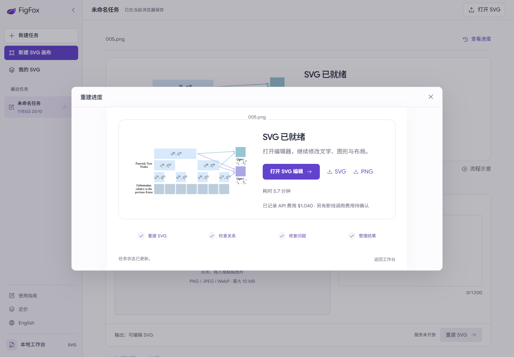

# Multi-stage input handling and connection recovery

## Observed failure

The user's `005.png` (609 × 277) completed G0 and G1, then failed before the G2 HTTP request: the four region comparisons plus four requested detail crops and 34,413 text bytes produced a conservative bound of **157,293**, above **131,072**. The previous integration handled overflowing SAM attachments in G0 only. G0/G1 had already recorded USD **0.474391**.

## Changes

- All three stages now prepare and validate the complete request before transport. Evidence sheets retain every comparison panel at its original pixel dimensions, with explicit panel labels and coordinate mapping. The failed G2 request becomes three attachments with a bound of **113,693**. No input/output limit was raised and no final SVG was manually edited.
- A failed, unsent later stage can continue after verifying the source, frozen configuration, G0 checkpoint and previous response hashes. Completed calls are reused. The original per-job budget includes all previous charges and outstanding reserves.
- The first continuation encountered a foreground `RemoteProtocolError` after 31.407 seconds, before receiving response headers. Its **USD 1.6384** reserve remains in the ledger; its actual charge is unknown.
- The local worker now uses the official [Responses background mode](https://developers.openai.com/api/docs/guides/background), preserving GPT-5.5 and `store=false`. It saves the response ID and polls the same task. GET interruptions retry retrieval, never creation. The provider temporarily retains background response state for polling as described in its documentation.
- A subsequent TLS handshake failure was confirmed to occur before the model HTTP request. The original receipt was retained, then reconciled as `not_submitted` with zero charge/reserve. Only `ConnectError`/`ConnectTimeout` receive bounded connection retries; read/write/protocol failures never repeat the POST. This distinction follows the [HTTPX transport documentation](https://www.python-httpx.org/advanced/transports/).
- UI shows recorded and unconfirmed charges separately, exposes continuation for verified checkpoints, and refreshes budget availability instead of leaving stale button state.

## Real result

One bounded verification of the new background transport completed **only G2**. The original eight recorded hashes (configuration, identity, G0 SVG/response/receipt, G1 model/response/receipt) remained unchanged.

| Item | Recorded result |
| --- | --- |
| G0 cost | USD 0.208556 |
| G1 cost | USD 0.265835 |
| Completed background G2 cost | USD 0.565215 |
| Total known cost | **USD 1.039606** |
| Retained ambiguous foreground reserve | **USD 1.6384**, not a confirmed charge |
| Total known + reserved exposure | USD 2.678006 |
| Original job budget | USD 4.228899, within the USD 5 single-image ceiling |
| Completed background G2 elapsed | 123.813 seconds |
| Total active processing, including failed attempts | 339.05 seconds; excludes troubleshooting wait |
| Final SVG SHA256 | `451a6312790d9c217c3b8cf6a5f3ff4cb030d51d617fd192907e811ed12f880d` |

The result passed file/hash verification, SVG/PNG download, editing/export and saved-edit reopening, and mobile layout checks. No additional model generation was performed by these browser checks. Reconstruction quality was not independently scored.

## Offline checks

- Full backend suite: 53 tests passed.
- Explicit coverage for all-stage request sizes, pixel-preserving evidence panels, oversized-input rejection, paid checkpoint reuse, hash mismatch, pending charges, duplicate recovery requests, GET reconnection, and connection-only reserve reconciliation.
- Mobile browser fixtures cover retry/continuation, duplicate clicks, reconnecting the progress dialog, unconfirmed billing and reduced motion.
- TypeScript, Ruff and production build checked; production remains isolated from localhost generation services.

These checks establish the fixes above and this real continuation. They do not establish an arbitrary-image success rate or a cloud deployment readiness claim.

