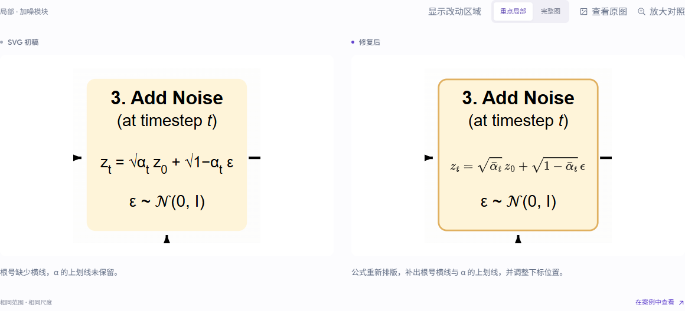
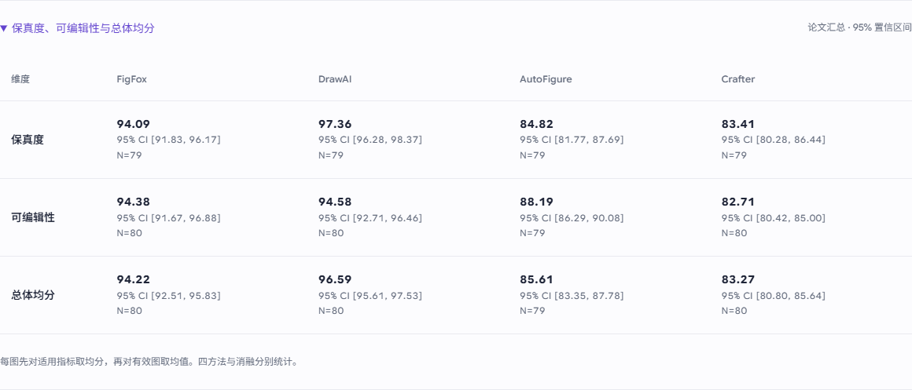
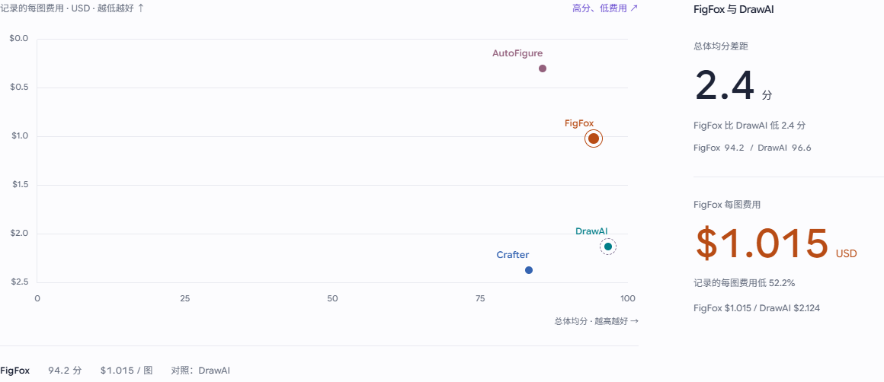

# Paper full-80 update and refinement-case repair

Reviewed on 2026-11-12. Source: the user-designated
`D:/Github_Ku/FigFox-926/fyp_experiment_materials/paper_full80_20261110`.
The earlier `paper_audit_20261110` and the old public mirror's `site/` are not inputs.

## Findings and changes

The paper's 112 current criterion cells (16 × four methods and 16 × three
configurations) were compared with the November 4 website snapshot. 91 matched
to the paper's two-decimal precision; all 21 changed scores are D13–D15.
The updated website matches all 112 cells and their effective sample sizes.
D09 remains a separately labeled historical score.

| Method / configuration | N | D13 | D14 | D15 |
| --- | ---: | ---: | ---: | ---: |
| FigFox Full | 80 | 97.50 | 96.25 | 89.38 |
| Without SAM3 | 80 | 97.50 | 97.50 | 93.13 |
| Draft only | 80 | 98.13 | 96.25 | 96.25 |
| AutoFigure-Edit | 79 | 96.20 | 74.68 | 93.67 |
| Crafter | 80 | 76.88 | 71.88 | 99.38 |
| DrawAI | 80 | 95.63 | 88.13 | 100.00 |

These are full-cohort web-editor means, using 1 / 0.5 / 0 for pass / partial /
fail. AFE sample-0062 is NA for all three editing criteria, excluded from N.
The old D14 common sets (12 comparison / 62 ablation) are not reused for this
review. This is a change of editing evaluation, not a new generation run.

The paper aggregates valid criteria within each image before averaging images.
The old site instead averaged 16 criterion means. The quality–cost chart now
uses the paper's overall score directly and is labeled “Overall mean”.
There is no attempt to reconstruct individual scores from aggregate tables.

| Scope | Method | Overall mean | 95% CI | N |
| --- | --- | ---: | --- | ---: |
| Comparison | FigFox | 94.22 | [92.51, 95.83] | 80 |
| Comparison | DrawAI | 96.59 | [95.61, 97.53] | 80 |
| Comparison | AutoFigure-Edit | 85.61 | [83.35, 87.78] | 79 |
| Comparison | Crafter | 83.27 | [80.80, 85.64] | 80 |
| Ablation | Full | 93.93 | [92.20, 95.54] | 80 |
| Ablation | Without SAM3 | 95.07 | [93.91, 96.21] | 80 |
| Ablation | Draft only | 88.46 | [86.25, 90.56] | 80 |

Expandable comparison and ablation tables also show fidelity and editability,
including their reported intervals and valid N. The two Full aggregates remain
separate. CI values are imported, not recalculated without the underlying data.

Resource records were reconciled with the paper and retained. Full's 80-image
known cost $78.76 plus $2.42 retained reserve explains the existing ~$1.015 per
image; recorded time remains 6.17 minutes. The paper's total known charge must
not replace a per-image value that includes reserves. The six configurations'
resource objects are byte-equivalent in parsed JSON to the previous snapshot.

## Individual records and reproducibility

The user confirmed that the latest individual 0/0.5/1 editing judgments are not
available. The browser therefore omits old editing judgments from result headers,
shows an update-pending notice, and places previous scores under
“Historical score · 2026-11-04”. Visual judgments and original artifacts remain
available. New editing aggregate count maps are empty; no pass / partial / fail
counts were inferred from means.

The original snapshot, downloads and counts are retained under
`frontend/public/assets/research/history/20261104/`. Current criterion CSVs use
one row per method and explicit valid N, scoring rule and individual-record
availability. `论文汇总评分.csv` contains the 21 paper aggregates and confidence
intervals. Old counts are linked explicitly as historical.

The three table inputs and their SHA256 hashes are checked in under
`frontend/scripts/research-paper-20261110/`. `python scripts/paper_summary.py`
reproduces the update; the full historical exporter invokes it after exporting
the original records. Repeated application is idempotent. This avoids reverting
the website to the binary editing review on the next export.

## Wrong comparison image

`refinementCases.ts` used array positions in the featured gallery. After the
gallery selection changed, the formula crop displayed the protein example and
the text-layout crop displayed another unrelated figure. They now resolve
`diffusion`, `study` and `vit` by stable ID from the complete case collection.
No original SVG or crop coordinates were edited.

## Validation

- TypeScript and the production Pages build pass.
- `research-data-check.py`: 480 original SVG hashes, 80 source identities,
  479 previews, historical scores and retained visual scores verified; the only
  damaged original remains AFE sample-0062.
- `paper-data-audit.py`: 112/112 paper criterion cells and effective Ns match.
- `research-check.mjs`: scores, best-cell highlighting, transitions, ranks,
  costs, sample comparison, downloads and bilingual layouts pass.
- `paper-summary-check.mjs`: all 21 aggregate cells and intervals, current CSVs,
  historical editing isolation and retained visual judgments pass in Chinese
  and English at desktop width and Chinese at 390px.
- `refinement-identity-check.mjs`: nine case/language/viewport combinations
  verify actual asset identity, target object and target visibility inside crop.
- Production Pages workspace check uses a synthetic gateway only; no model run,
  account changes or cloud service restart is performed.

This release changes presentation data and the static frontend only. The
generation kernel, prompts, billing ledger and original research artifacts are
unchanged. Latest individual editing records remain the one data limitation.
